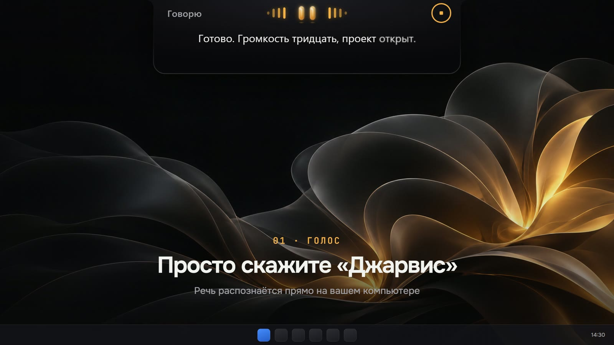
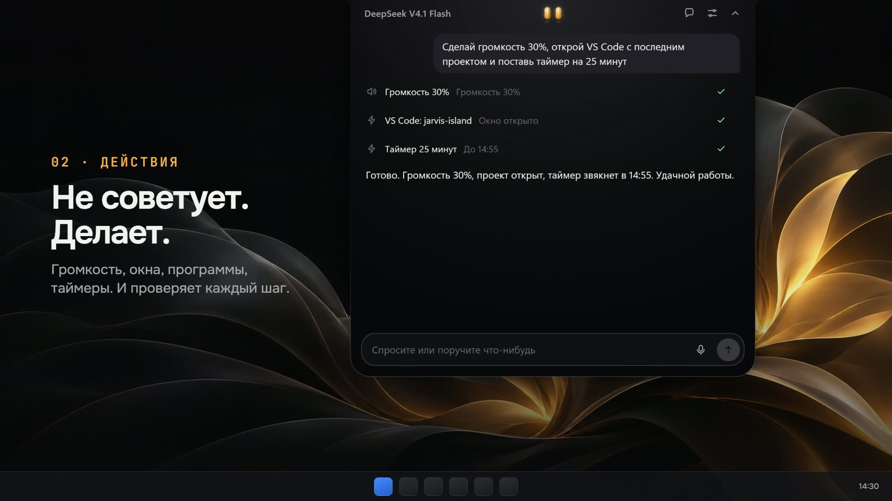
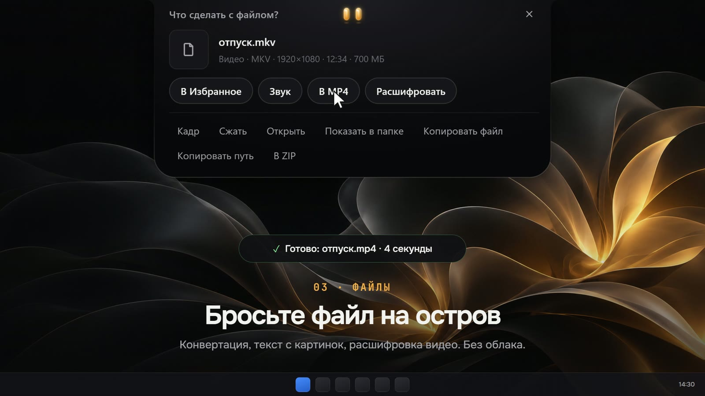
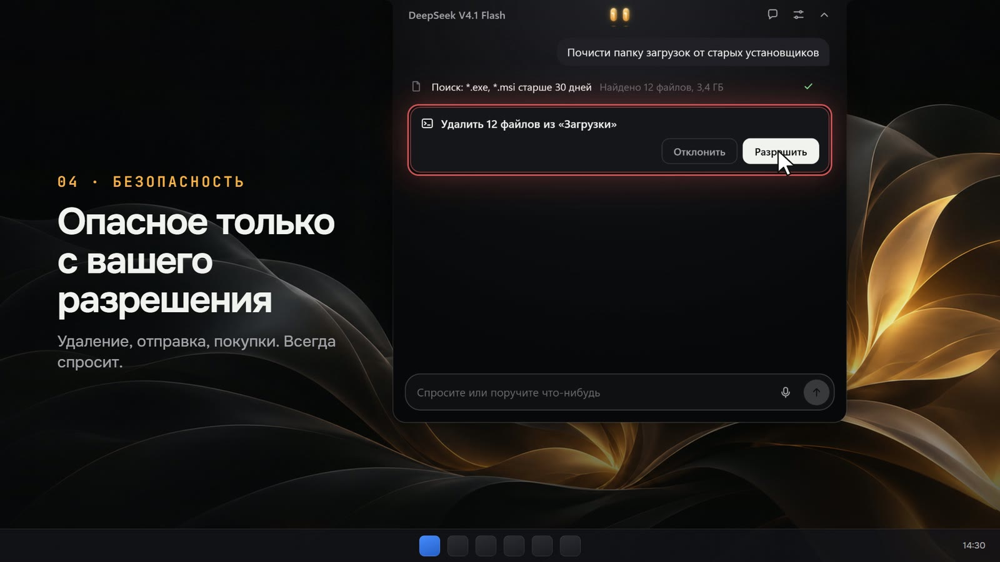

<div align="center">


# JARVIS

**Dynamic Island для Windows с ИИ-агентом внутри.**<br>
Говорите с ним голосом, и он делает дело на вашем компьютере.

[](https://github.com/Sansay411/jarvis-island/releases/latest)
[](#установка)
[](LICENSE)

<sub>Rust · Tauri 2 · React 19 · локальный голос · любая модель, включая Ollama</sub>

</div>

<br>

<div align="center">
<a href="https://github.com/Sansay411/jarvis-island/releases/download/v0.1.1/jarvis-demo.mp4">

</a>
<br>
<sub>▶ <a href="https://github.com/Sansay411/jarvis-island/releases/download/v0.1.1/jarvis-demo.mp4">Полное демо в 1080p, 39 секунд</a></sub>
</div>

<br>

Джарвис живёт в маленьком острове у верхнего края экрана. Наведите курсор, и остров раскроется в чат. Скажите «Джарвис» или нажмите `Ctrl+Alt+K`, и он слушает. Два янтарных глаза показывают, что он делает: думает, слушает, говорит, рад или растерян.

Это не болталка. Джарвис меняет громкость и яркость, запускает программы, раскладывает окна, читает вкладки браузера, кликает по интерфейсу, конвертирует файлы и ставит таймеры. После каждого действия он проверяет, что получилось, и только потом отвечает.

## Почему он другой

<table>
<tr>
<td width="33%" valign="top">

### 🪶 Нативный
Rust и системные API Windows. Никакого Electron, Python и фонового Node.js. В покое остров не тратит процессор.

</td>
<td width="33%" valign="top">

### 🔒 Приватный
Речь распознаётся на вашем компьютере. Модели уходит только текст. Ключи лежат в диспетчере учётных данных Windows.

</td>
<td width="33%" valign="top">

### 🧠 Любая модель
DeepSeek по умолчанию. Также OpenAI, OpenRouter, Model Studio, Ollama и любой OpenAI-совместимый API.

</td>
</tr>
</table>

## Как это выглядит

<table>
<tr>
<td width="50%"><br><b>Голос.</b> Скажите «Джарвис», он слушает и отвечает голосом. Речь распознаётся на компьютере.</td>
<td width="50%"><br><b>Действия.</b> Одна просьба, несколько шагов. Каждый проверен, прежде чем Джарвис ответит.</td>
</tr>
<tr>
<td width="50%"><br><b>Файлы.</b> Бросьте файл на остров, и он предложит, что с ним сделать.</td>
<td width="50%"><br><b>Безопасность.</b> Удаление, отправка и покупки идут только после вашего «Разрешить».</td>
</tr>
</table>

## Что умеет

| | |
|---|---|
| 🎚️ **Система** | Громкость общая и для отдельных программ, яркость встроенного и внешнего монитора, музыка: трек, обложка, пауза, переключение |
| 🪟 **Окна и программы** | Запуск любой программы из «Пуска», фокус, свернуть, развернуть, закрыть, разложить по сторонам экрана |
| 🖱️ **Управление экраном** | Снимок экрана или окна, клики, ввод текста, сочетания клавиш, прокрутка, кнопки и поля через UI Automation |
| 🌐 **Браузер** | Список вкладок, переключение, текст страницы. Chrome, Edge, Яндекс Браузер, Brave, Opera, Vivaldi, Firefox. Без расширений |
| 🔎 **Интернет** | Поиск и чтение страниц со ссылками на источники |
| 🎙️ **Голос** | Распознавание GigaAM v3 и нейросетевой голос Supertonic или Piper прямо на компьютере. Отвечает с первой готовой фразы, его можно перебить. Можно включить Qwen Omni Realtime |
| 📁 **Файлы** | Перетащите файл на остров: MKV в MP4 без перекодирования, звук из видео, PNG, WebP, JPG, текст с картинок и PDF, страницы PDF в картинки, ZIP, удаление EXIF, расшифровка аудио в .txt и .srt |
| ⏰ **Таймеры** | «Таймер на 25 минут», «напомни через час позвонить», «напомни в 18:30». Переживают перезапуск |
| 💻 **Разработка** | VS Code и недавние проекты, Claude Code и Codex фоновыми задачами, терминал и PowerShell |
| 🔌 **MCP** | Подключение любых серверов Model Context Protocol. Конфиг из Claude Desktop, Cursor или VS Code вставляется целиком |
| 💬 **Характер** | С ним можно просто поговорить. Помнит факты о вас. Имя, «ты» или «вы» и манеру общения можно поменять в настройках |

Простые команды вроде «громкость 30» или «пауза» выполняются сразу, без запроса к модели.

## Установка

1. Откройте [последний релиз](https://github.com/Sansay411/jarvis-island/releases/latest).
2. Скачайте **`Jarvis_x.y.z_x64-setup.exe`** и запустите. Права администратора не нужны.
3. Джарвис появится вверху экрана и в трее.

Если не хочется устанавливать, в релизе есть **`jarvis-portable.exe`**. Это один файл, его можно запускать откуда угодно. Ему нужен WebView2, в Windows 11 он уже есть.

> [!NOTE]
> Windows SmartScreen может предупредить о неизвестном издателе: сборка не подписана сертификатом. Нажмите «Подробнее», затем «Выполнить в любом случае».

## Первый запуск

1. Откройте настройки через меню в трее.
2. В разделе **«Модель»** выберите провайдера, вставьте API-ключ и нажмите «Проверить подключение». Для Ollama ключ не нужен.
3. В разделе **«Голос»** скачайте распознавание GigaAM v3 (170 МБ) и голос Supertonic 3 (129 МБ) или Piper. Кнопка «Прослушать» даст послушать образец.

Без скачанного голоса Джарвис говорит стандартным голосом Windows.

> [!IMPORTANT]
> Голосовое распознавание пока понимает только русский язык. Чат и все действия работают на любом языке, который понимает выбранная модель.

## Управление

| Что | Как |
|---|---|
| Раскрыть остров | Навести курсор |
| Чат | `Ctrl+Alt+J`, клик по острову или трей |
| Голос | `Ctrl+Alt+K`, кнопка микрофона или «Джарвис, …» |
| Замолчать | «Стоп» или «хватит» |
| Закрыть | `Esc` или клик мимо острова |
| Остановить задачу | Кнопка «стоп» в чате или пункт в трее |

<details>
<summary><b>Командная строка</b></summary>

<br>

Работает, когда Джарвис уже запущен:

```bash
jarvis.exe --settings
jarvis.exe --ask "сделай громкость 30% и открой проводник"
jarvis.exe --command toggle-voice
jarvis.exe --command cancel-task
jarvis.exe --command new-conversation
```

</details>

## Безопасность

Джарвис управляет настоящим компьютером, поэтому осторожность встроена в каждое действие.

* **Чтение выполняется сразу.** Изменения файлов, команды и закрытие окон идут с подтверждением, это настраивается.
* **Опасное подтверждается всегда.** Удаление, установка, отправка сообщений, нажатия на «Отправить», «Удалить», «Купить». Enter в мессенджере тоже считается отправкой, и в подтверждении видно, кому уходит сообщение.
* **Чужой текст не командует.** Страницы, файлы, буфер обмена и вывод команд передаются модели как недоверенные данные.
* **Снимки экрана и звук не сохраняются на диск.** Экран снимается только по ходу задачи.
* **Ключ модели уходит только на тот адрес,** для которого он сохранён.
* **Инструменты MCP проходят те же проверки.** Разрушительные подтверждаются каждый раз, даже в режиме полного управления.
* **Все рискованные действия записываются** в журнал `audit_log` в `%LOCALAPPDATA%\dev.jarvis.desktop\jarvis.db`.

## Сборка из исходников

<details>
<summary><b>Что понадобится и как собрать</b></summary>

<br>

* Windows 10 или 11, x64
* [Rust](https://rustup.rs) stable с MSVC
* Visual Studio Build Tools с компонентом «Desktop development with C++» и Windows SDK
* Node.js 20 или новее
* WebView2 Runtime

```bash
npm install
npm run tauri dev
```

Установщик собирается так:

```bash
npm run tauri build
```

Готовый файл появится в `src-tauri/target/release/bundle/nsis`. Собирайте релиз только через `tauri build`: обычный `cargo build --release` грузит интерфейс с dev-сервера.

При первой сборке `sherpa-onnx-sys` скачивает готовые библиотеки sherpa-onnx. Они собраны со статическим CRT, поэтому всё приложение линкуется с `+crt-static`, и Visual C++ Redistributable пользователю не нужен.

</details>

<details>
<summary><b>Диагностика</b></summary>

<br>

* Журнал: `%LOCALAPPDATA%\dev.jarvis.desktop\logs\jarvis.log`
* В настройках есть раздел «Диагностика»: память, мониторы, задержки голоса.
* Нативные интеграции проверяются без интерфейса:

```bash
cargo run --example probe -- audio
cargo run --example probe -- windows
cargo run --example probe -- browser
cargo run --example probe -- asr a.wav
cargo run --example probe -- files-run convert:png photo.heic
```

</details>

## Как устроен

| Документ | О чём |
|---|---|
| [ARCHITECTURE.md](docs/ARCHITECTURE.md) | Модули, агент, инструменты, хранилище |
| [DESIGN.md](docs/DESIGN.md) | Визуальный язык острова и глаз |
| [VOICE-PERFORMANCE.md](docs/VOICE-PERFORMANCE.md) | Замеры и устройство голосового конвейера |
| [TASKS.md](TASKS.md) | Что сделано и что проверено вживую |
| [IDEAS.md](docs/IDEAS.md) | Идеи на будущее |

## Участие

Баг-репорты, идеи и пулреквесты приветствуются. Если что-то сломалось, приложите кусок журнала `jarvis.log` и опишите, что вы просили сделать.

## Лицензия

[MIT](LICENSE). Пользуйтесь, меняйте, встраивайте.

<div align="center">
<br>
<sub>Если Джарвис вам пригодился, поставьте ⭐. Так о нём узнают другие.</sub>
</div>
