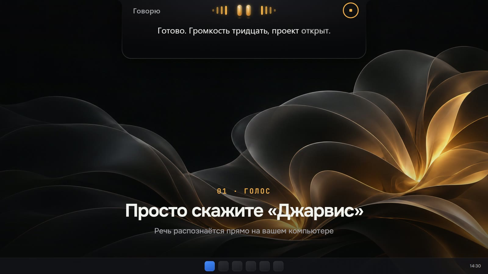
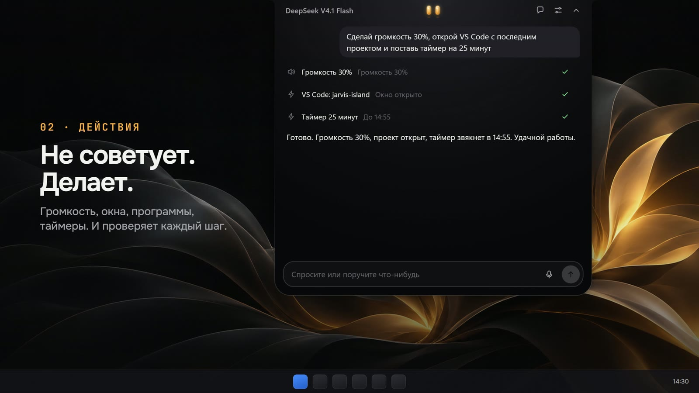
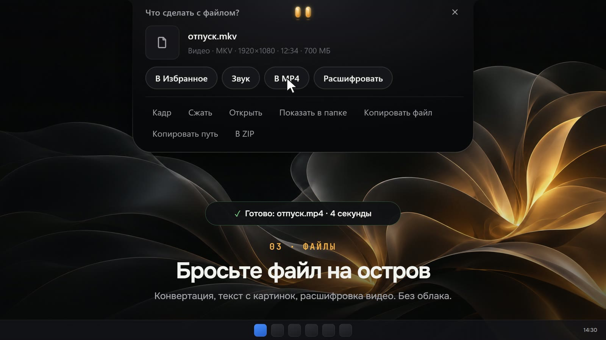
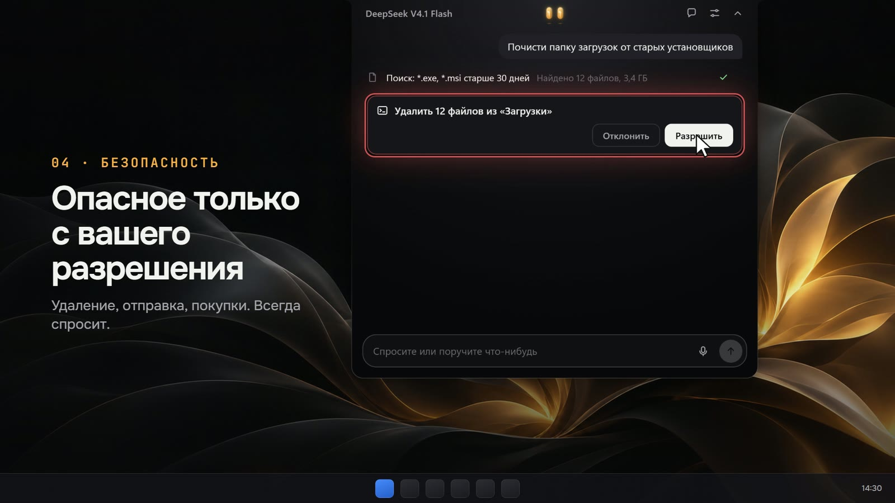

<div align="center">


# JARVIS

**Dynamic Island для Windows с ИИ-агентом внутри.**<br>
Говорите с ним голосом, и он делает дело на вашем компьютере.

[](https://github.com/Sansay411/jarvis-island/releases/latest)
[](#установка)
[](LICENSE)

<sub>Rust · Tauri 2 · React 19 · локальный голос · любая модель, включая Ollama</sub>

</div>

<br>

<div align="center">
<a href="https://github.com/Sansay411/jarvis-island/releases/download/v0.1.1/jarvis-youtube-ad.mp4">

</a>
<br>
<sub>▶ <a href="https://github.com/Sansay411/jarvis-island/releases/download/v0.1.1/jarvis-youtube-ad.mp4">Ролик с озвучкой, 1080p, 80 с</a> · <a href="https://github.com/Sansay411/jarvis-island/releases/download/v0.1.1/jarvis-ad.mp4">Короткая версия</a> · <a href="https://github.com/Sansay411/jarvis-island/releases/download/v0.1.1/jarvis-demo.mp4">Подробное демо</a></sub>
</div>

<br>

Джарвис живёт в маленьком острове у верхнего края экрана. Наведите курсор — раскроется командный хаб с музыкой, календарём задач, таймером фокуса, полкой файлов и картой активности; кликните или нажмите `Ctrl+Alt+J` — откроется чат. Скажите «Джарвис» или нажмите `Ctrl+Alt+K`, и он слушает. Два янтарных глаза в центре всегда показывают, что он делает: думает, слушает, говорит, рад или растерян.

Это не болталка. Джарвис меняет громкость и яркость, запускает программы, раскладывает окна по сетке, ведёт пошаговый план задачи, читает вкладки браузера и выделенный текст, конвертирует файлы, следит за сессиями фокуса и озвучивает сводки чистым нейросетевым голосом. После каждого действия он проверяет результат и только потом отвечает.

## Почему он другой

<table>
<tr>
<td width="33%" valign="top">

### 🪶 Нативный
Rust и системные API Windows. Никакого Electron, Python и фонового Node.js. В покое остров не тратит процессор.

</td>
<td width="33%" valign="top">

### 🔒 Приватный
Речь распознаётся на вашем компьютере. Модели уходит только текст. Ключи лежат в диспетчере учётных данных Windows.

</td>
<td width="33%" valign="top">

### 🧠 Любая модель
DeepSeek по умолчанию. Также OpenAI, OpenRouter, Model Studio, Ollama и любой OpenAI-совместимый API.

</td>
</tr>
</table>

## Как это выглядит

<table>
<tr>
<td width="50%"><br><b>Голос.</b> Скажите «Джарвис», он слушает и отвечает голосом. Речь распознаётся на компьютере.</td>
<td width="50%"><br><b>Действия.</b> Одна просьба, несколько шагов. Каждый проверен, прежде чем Джарвис ответит.</td>
</tr>
<tr>
<td width="50%"><br><b>Файлы.</b> Бросьте файл на остров, и он предложит, что с ним сделать.</td>
<td width="50%"><br><b>Безопасность.</b> Удаление, отправка и покупки идут только после вашего «Разрешить».</td>
</tr>
</table>

## Что умеет

| | |
|---|---|
| 🎚️ **Система и диагностика** | Громкость общая и для отдельных программ, яркость встроенного и внешнего монитора, музыка с перемоткой по таймлайну и значком плеера, живая телеметрия ПК (CPU, ОЗУ, диск C:, батарея, топ процессов) |
| 🪟 **Окна и раскладки** | Запуск программ из «Пуска», фокус, свернуть, развернуть, закрыть, снимок и восстановление раскладки окон, тайлинг пары окон 50/50 или 65/35, уборка лишних окон для фокуса (`window_layout`) |
| ⚡ **Автопилот и сценарии** | Режим полного управления (`Автопилот ⚡`), живой чек-лист шагов (`План миссии`) на острове и в чате, готовые и свои сценарии (`Глубокая работа`, `Утренний брифинг`, `Порядок в окнах`, `Диагностика ПК`), чтение выделенного текста без порчи буфера (`selection_grab`) |
| 🖱️ **Управление экраном** | Снимок экрана или окна, клики, ввод текста, сочетания клавиш, прокрутка, кнопки и поля через UI Automation |
| 🌐 **Браузер** | Список вкладок, переключение, текст страницы. Chrome, Edge, Яндекс Браузер, Brave, Opera, Vivaldi, Firefox. Без расширений |
| 🔎 **Интернет** | Поиск и чтение страниц со ссылками на источники |
| 🎙️ **Бесплатная HD-озвучка и голос** | Потоковые нейросетевые голоса Edge Neural HD (*Дмитрий HD*, *Светлана HD*, *Andrew Multilingual HD*, *Ryan HD*) работают сразу из коробки без ключей и скачивания: первый звук за ~240–300 мс (прогретый WebSocket-пул) и <6 мс из двухуровневого кэша ОЗУ/диска. Кнопка «Озвучить» на сообщениях, автоозвучка ответов, офлайн-фолбэк на локальные Supertonic 3 / Piper или голос Windows; распознавание речи GigaAM v3 на компьютере и режим Qwen Omni Realtime |
| 🎯 **Фокус и календарь** | Вкладка «Обзор» с 7-дневным календарём и повесткой дня, баннер фокуса при наведении и двухколоночная дека «Фокус» с кольцевым таймером, задачами по цветам и голосовой отбивкой по завершении |
| 📥 **Полка и стрик активности** | Вкладка «Полка» в острове для временного хранения файлов, ссылок и заметок («На полку», «В чат», «Озвучить»); вкладка «Стрик» с честной 52-недельной картой продуктивности из SQLite и локальных Git-коммитов |
| 📁 **Файлы** | Перетащите файл на остров: положить на полку, MKV в MP4 без перекодирования, звук из видео, PNG, WebP, JPG, текст с картинок и PDF, страницы PDF в картинки, ZIP, удаление EXIF, расшифровка аудио в .txt и .srt |
| 📋 **Буфер обмена** | История скопированного: текст, картинки, списки файлов. Поиск, закрепление и вставка в то окно, где вы печатали. Пароли и ключи не записываются, всё остаётся на компьютере. Можно сказать «вставь то, что я копировал час назад» |
| ⏰ **Таймеры** | «Таймер на 25 минут», «фокус на 45 минут», «напомни через час позвонить», «напомни в 18:30». Переживают перезапуск |
| 💻 **Разработка** | VS Code и недавние проекты, Claude Code и Codex фоновыми задачами, терминал и PowerShell |
| 🔌 **MCP** | Подключение любых серверов Model Context Protocol. Конфиг из Claude Desktop, Cursor или VS Code вставляется целиком |
| 🎧 **Наушники** | Вкладка «Звук»: заряд каждого AirPods и кейса, «заряжается» и «в ухе», сколько ещё хватит и расход за день, куда идёт звук, заряд мыши и клавиатуры. Предупреждение на 20 % и 10 % |
| 📌 **Закрепить остров** | Булавка в шапке оставляет остров открытым, пока его не открепишь |
| 💬 **Характер** | С ним можно просто поговорить. Помнит факты о вас. Имя, «ты» или «вы» и манеру общения можно поменять в настройках |

Простые команды вроде «громкость 30», «пауза», «дальше», «назад» или «верни музыку» выполняются сразу, без запроса к модели. Команды плеера — «пауза», «играй», «дальше», «назад», «стоп» — работают и без имени, от любого голоса; остальное без «Джарвис, …» он не слушает.

## Установка

1. Откройте [последний релиз](https://github.com/Sansay411/jarvis-island/releases/latest).
2. **Windows:** скачайте **`Jarvis-x.y.z-Setup.exe`** и запустите — установщик сам всё поставит, права администратора не нужны.
   **macOS:** скачайте DMG для своего Mac (`aarch64` — Apple Silicon, `x64` — Intel) и перетащите Джарвиса в «Программы».
3. Джарвис появится вверху экрана и в трее.

Дальше Джарвис обновляется сам: раз в шесть часов проверяет релизы на GitHub и предлагает поставить новую версию в один клик (пакет проверяется подписью). Проверить вручную — «Настройки → Основное → Обновления» или пункт в трее.

Если не хочется устанавливать, в релизе есть **`jarvis-portable.exe`**. Это один файл, его можно запускать откуда угодно. Ему нужен WebView2, в Windows 11 он уже есть. Portable-версия не обновляется сама.

> [!NOTE]
> Windows SmartScreen может предупредить о неизвестном издателе: сборка пока не подписана сертификатом (подпись подключается, см. [Code signing policy](#code-signing-policy)). Нажмите «Подробнее», затем «Выполнить в любом случае».

**Удаление:** «Параметры → Приложения → Jarvis → Удалить». Откроется окно в том же стиле, что и установщик. Голосовые модели и кэш удаляются по умолчанию, а настройки, история и ключи API — только если отметить их галочкой: иначе после переустановки всё вернётся как было.

## Первый запуск

1. Откройте настройки через меню в трее.
2. В разделе **«Модель»** выберите провайдера, вставьте API-ключ и нажмите «Проверить подключение». Для Ollama ключ не нужен.
3. В разделе **«Голос»** студийные голоса **Edge Neural HD** (*Дмитрий HD*, *Светлана HD*, *Andrew Multilingual HD*, *Ryan HD*) уже включены бесплатно и без ключей — нажмите «Прослушать» или «Замерить задержку». Для голосового ввода с микрофона скачайте локальное распознавание GigaAM v3 (170 МБ), а для работы полностью без интернета — локальный голос Supertonic 3 (129 МБ) или Piper.

При отсутствии сети Джарвис автоматически переключается на скачанный локальный нейросетевой голос или системный голос Windows.

> [!IMPORTANT]
> Голосовое распознавание пока понимает только русский язык. Чат и все действия работают на любом языке, который понимает выбранная модель.

## Управление

| Что | Как |
|---|---|
| Раскрыть остров (`Обзор · Фокус · Полка · Стрик`) | Навести курсор |
| Переключить вкладку острова | Клик по пилюле, `Alt+1..4` или горизонтальный свайп |
| Чат и автопилот | `Ctrl+Alt+J`, кнопка чата в острове или иконка в трее |
| Голос | `Ctrl+Alt+K`, кнопка микрофона или «Джарвис, …» |
| История буфера | `Ctrl+Alt+V` (поиск, `Enter` вставляет) или кнопка в раскрытом острове (клик по записи вставляет) |
| Замолчать | Кнопка «Стоп звук», «стоп» или «хватит» |
| Музыка голосом | «Джарвис, пауза / играй / дальше / назад», «что играет?»; «Джарвис, стоп» в тишине ставит музыку на паузу |
| Закончить разговор | «Всё, спасибо», «отбой», «можешь отдыхать» |
| Закрыть | `Esc` или клик мимо острова |
| Остановить задачу | Кнопка «стоп» в чате или пункт в трее |

<details>
<summary><b>Командная строка</b></summary>

<br>

Работает, когда Джарвис уже запущен:

```bash
jarvis.exe --settings
jarvis.exe --ask "сделай громкость 30% и открой проводник"
jarvis.exe --command toggle-voice
jarvis.exe --command cancel-task
jarvis.exe --command new-conversation
```

</details>

## Безопасность

Джарвис управляет настоящим компьютером, поэтому осторожность встроена в каждое действие.

* **Чтение выполняется сразу.** Изменения файлов, команды и закрытие окон идут с подтверждением, это настраивается.
* **Опасное подтверждается всегда.** Удаление, установка, отправка сообщений, нажатия на «Отправить», «Удалить», «Купить». Enter в мессенджере тоже считается отправкой, и в подтверждении видно, кому уходит сообщение.
* **Чужой текст не командует.** Страницы, файлы, буфер обмена и вывод команд передаются модели как недоверенные данные.
* **Снимки экрана и звук не сохраняются на диск.** Экран снимается только по ходу задачи.
* **Ключ модели уходит только на тот адрес,** для которого он сохранён.
* **Инструменты MCP проходят те же проверки.** Разрушительные подтверждаются каждый раз, даже в режиме полного управления.
* **Все рискованные действия записываются** в журнал `audit_log` в `%LOCALAPPDATA%\dev.jarvis.desktop\jarvis.db`.

## Конфиденциальность

У Джарвиса нет своего сервера, аккаунтов и телеметрии. Речь распознаётся на компьютере, а в сеть уходит только то, что вы включили: запросы к выбранному вами провайдеру модели, облачные голоса, погода по просьбе и проверка обновлений на GitHub. Подробно, что и куда, — в [PRIVACY.md](PRIVACY.md).

## Сборка из исходников

<details>
<summary><b>Что понадобится и как собрать</b></summary>

<br>

* Windows 10 или 11, x64
* [Rust](https://rustup.rs) stable с MSVC
* Visual Studio Build Tools с компонентом «Desktop development with C++» и Windows SDK
* Node.js 20 или новее
* WebView2 Runtime

```bash
npm install
npm run tauri dev
```

Установщик собирается так:

```bash
npm run tauri build
```

Готовый файл появится в `src-tauri/target/release/bundle/nsis`. Собирайте релиз только через `tauri build`: обычный `cargo build --release` грузит интерфейс с dev-сервера.

При первой сборке `sherpa-onnx-sys` скачивает готовые библиотеки sherpa-onnx. Они собраны со статическим CRT, поэтому всё приложение линкуется с `+crt-static`, и Visual C++ Redistributable пользователю не нужен.

</details>

<details>
<summary><b>Диагностика</b></summary>

<br>

* Журнал: `%LOCALAPPDATA%\dev.jarvis.desktop\logs\jarvis.log`
* В настройках есть раздел «Диагностика»: память, мониторы, задержки голоса.
* Нативные интеграции проверяются без интерфейса:

```bash
cargo run --example probe -- audio
cargo run --example probe -- windows
cargo run --example probe -- browser
cargo run --example probe -- asr a.wav
cargo run --example probe -- files-run convert:png photo.heic
cargo run --example tts_bench
```

</details>

## Как устроен

| Документ | О чём |
|---|---|
| [ARCHITECTURE.md](docs/ARCHITECTURE.md) | Модули, агент, инструменты, хранилище |
| [DESIGN.md](docs/DESIGN.md) | Визуальный язык острова и глаз |
| [VOICE-PERFORMANCE.md](docs/VOICE-PERFORMANCE.md) | Замеры и устройство голосового конвейера |
| [TASKS.md](TASKS.md) | Что сделано и что проверено вживую |
| [IDEAS.md](docs/IDEAS.md) | Идеи на будущее |

## Участие

Баг-репорты, идеи и пулреквесты приветствуются. Если что-то сломалось, приложите кусок журнала `jarvis.log` и опишите, что вы просили сделать.

## Code signing policy

Free code signing provided by [SignPath.io](https://signpath.io), certificate by [SignPath Foundation](https://signpath.org).

* Signed are only Windows builds made by this repository's [release workflow](.github/workflows/release.yml) on GitHub-hosted runners from a version tag. Every release is approved by hand.
* Committers and reviewers: [Sansay411](https://github.com/Sansay411)
* Approvers: [Sansay411](https://github.com/Sansay411)
* Privacy policy: [PRIVACY.md](PRIVACY.md). This program will not transfer any information to other networked systems unless specifically requested by the user or the person installing or operating it.

## Лицензия

[MIT](LICENSE). Пользуйтесь, меняйте, встраивайте.

<div align="center">
<br>
<sub>Если Джарвис вам пригодился, поставьте ⭐. Так о нём узнают другие.</sub>
</div>
